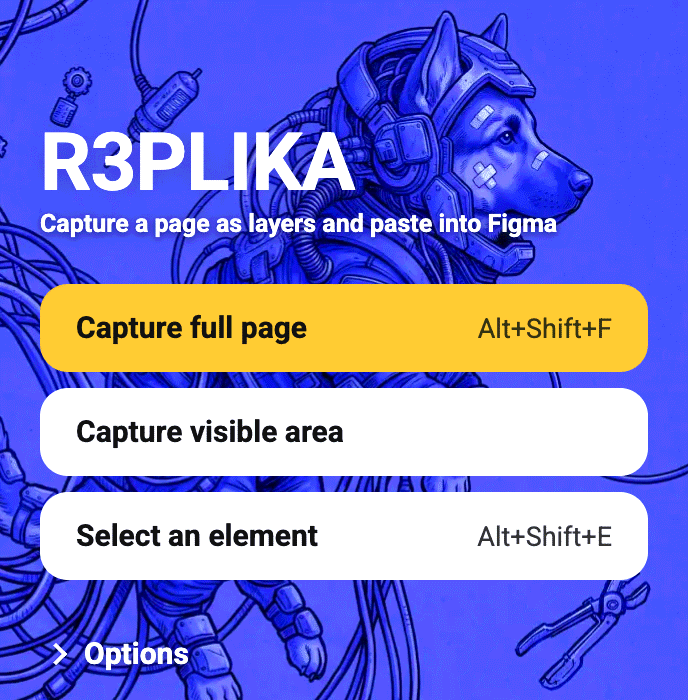
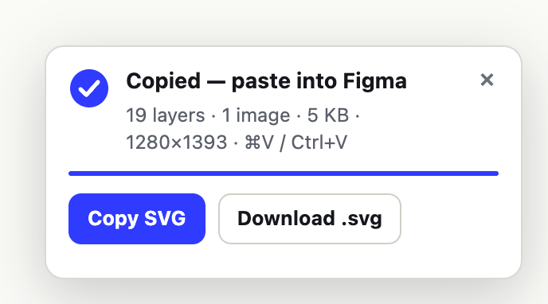
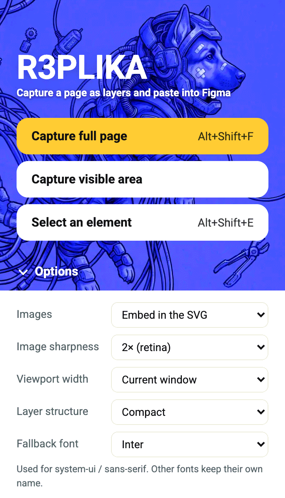
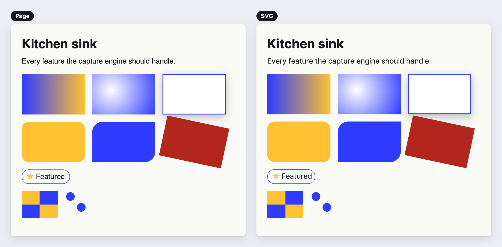

# R3PLIKA

A Chrome extension that captures a whole page, the visible area, or any single element as a **layered SVG** and copies it to your clipboard. Paste it into Figma (`Cmd/Ctrl + V`) and you get real layers: rectangles, text, vector icons and images, not a flat screenshot.

No server, no account, no analytics, no Figma plugin. Everything happens inside your browser.

## Screenshots

<p align="center">
  
  &nbsp;&nbsp;
  
</p>

**Options panel**

<p align="center">
  
</p>

**A test page next to its captured SVG**



## Install

R3PLIKA is not on the Chrome Web Store yet. Load it unpacked:

1. Download or clone this repository.
2. Open `chrome://extensions`.
3. Turn on **Developer mode** (top right).
4. Click **Load unpacked** and choose the repository folder (the one containing `manifest.json`).
5. Pin the extension from the puzzle-piece menu.

To capture local `file://` pages, open the extension's **Details** and enable **Allow access to file URLs**.

Requires Chrome 111 or later.

## Usage

| Action | Popup button | Shortcut |
|---|---|---|
| Whole page, top to bottom | Capture full page | `Alt+Shift+F` |
| Only what is on screen | Capture visible area | |
| One component or section | Pick an element | `Alt+Shift+E` |

**Pick an element:** hover to highlight, `↑` selects the parent, `↓` goes back to the child, click (or `Enter`) captures, `Esc` cancels.

When the capture finishes, a small card appears on the page. By default the SVG is already on your clipboard, so switch to Figma and paste. The card also has **Copy SVG** and **Download .svg** buttons.

> If pasting into Figma does nothing, click **Download .svg** and drag the file onto the Figma canvas. That always works.

Figma names the pasted frame after the page address (for example `example.com/pricing`). Element captures are named after the element instead.

You can change the shortcuts at `chrome://extensions/shortcuts`.

## Options

Open **Options** in the popup. Settings are saved locally in the browser (`chrome.storage.local`).

| Option | What it does |
|---|---|
| Images | Embed them in the SVG, or leave grey placeholders (fast, tiny file). |
| Image sharpness | Maximum pixel density of embedded images (1x / 2x / 3x). Larger images are downscaled. Photos are re-encoded as JPEG; anything with transparency stays PNG. |
| Viewport width | Capture the page at 375 / 430 / 768 / 1024 / 1280 / 1440 / 1920 px. Uses Chrome's device emulation through the **debugger** permission. Chrome shows a "debugging this browser" bar for a few seconds while it runs. The debugger only attaches when you pick a width. |
| Layer structure | *Compact* skips wrapper elements that paint nothing. *Full* keeps every element as a group. |
| Fallback font | Used for generic families (`sans-serif`, `system-ui`, `-apple-system`, ...). Default `Inter`. |
| Scroll first to load lazy content | Scrolls through the page before capturing so lazy images and reveal-on-scroll sections appear. |
| Include fixed & sticky bars | Keep `position: fixed` elements such as cookie banners and sticky headers. |
| Include invisible elements | Keep `opacity: 0` elements. |
| Add a white page background | Put a white rectangle behind the page when it has no background. |
| Copy automatically | Turn off to only get the card with buttons. |

## What is captured

- **Boxes:** backgrounds, linear / radial / repeating / conic gradients, background images (size, position, repeat), per-corner radii, solid / dashed / dotted / double / mixed-colour borders, outlines, outer and inset shadows.
- **Text as real text:** font, weight, size, letter and word spacing, `text-transform`, underline / strikethrough, text shadow, text stroke, gradient text (`background-clip: text`), ellipsis truncation, RTL, one text layer per rendered line.
- `::before` / `::after` content, list bullets and numbers.
- **Images:** `object-fit` / `object-position`, `<picture>` / `srcset`, SVG images (kept as vectors), canvas, video frames.
- **Inline `<svg>`:** CSS classes baked in, `<use>` / `<symbol>` resolved, ids made unique.
- Transforms (including the `translate` / `rotate` / `scale` properties), opacity, `filter`, `mix-blend-mode`, `clip-path`, `overflow` clipping.
- Open shadow DOM and slots, same-origin iframes.
- **Form controls:** inputs, placeholders, textarea wrapping, select, checkbox, radio.

Editable boxes become `<rect>` elements, so Figma turns them into rectangles. Layer names come from the element's `id`, first class, or tag.

## Known limits

- `backdrop-filter` and CSS `mask-image` have no SVG equivalent and are skipped.
- Icon fonts show up as text, and the font has to be installed in Figma for the icons to show. More generally, fonts that are not available in Figma fall back to whatever Figma picks. Google Fonts and system fonts are usually fine.
- Text is split per line, so editing a paragraph in Figma will not reflow like HTML.
- Stacking (`z-index`) is resolved per parent. That matches almost every real layout but is approximate for deeply nested stacking contexts.
- Cross-origin iframes become a grey placeholder. Tainted canvases and DRM video cannot be read.
- Captures are capped at 40,000 elements (a warning is shown). In testing, a 25,000-layer page produced a 3.7 MB SVG in about 3 seconds.
- Table cells with `border-collapse: collapse` draw each cell's own border, so shared edges can look slightly heavier.
- The page is briefly modified while capturing (pseudo-elements are swapped for real nodes and animations are frozen), then restored.

## Privacy

- No server, no account, no analytics, no tracking.
- Image URLs found on the page are fetched by the extension's background worker purely to embed them in the SVG. These requests use your cookies, so images behind a login still work. Nothing else is fetched, and nothing is sent anywhere else.
- The SVG goes to your clipboard or your downloads folder and nowhere else.
- Options are stored locally with `chrome.storage.local`.

### Why each permission is needed

| Permission | Used for |
|---|---|
| `activeTab`, `scripting` | Injecting the capture script into the tab you capture. |
| `<all_urls>` (host access) | Fetching images from other domains (with your cookies) so they can be embedded in the SVG. |
| `clipboardWrite` | Copying the SVG to the clipboard. |
| `storage` | Remembering your options. |
| `debugger` | Only for the *Viewport width* option (device emulation). Chrome does not allow this permission to be optional. |

## Responsible use

Captured pages are someone else's design and code. Use captures for reference, learning and your own sites. Don't republish other people's work.

## Motion

The popup and the on-page card are lightly animated: staggered entrance, title decode, slow artwork drift, title flicker and glitch, button shine and lift, a springy Options panel, a popup fade on capture, and a scan sweep that outlines the captured layers on the page.

- Everything is transform / opacity only and respects the system "reduce motion" setting.
- To change the overall pace, edit `--s` at the top of the `<style>` block in `popup/popup.html` (1 = as designed, 0.5 = twice as fast).
- The popup window itself cannot animate (Chrome owns it), so only its contents move.

## Project layout

```
manifest.json         MV3 manifest
background.js         service worker: injection, image fetching, shortcuts, viewport emulation
content/lib.js        pure helpers (colours, gradients, radii, filters, shadows, clip-path)
content/capture.js    the capture engine, result card, element picker and scan sweep
popup/                popup UI (CSS and fonts are inlined in popup.html on purpose: fewer files = faster open)
icons/                16 / 32 / 48 / 128 px
```

The repository folder is the extension. After editing, click the reload icon on the extension in `chrome://extensions`, then **refresh the tab you want to capture**.

## License

The **code** is released under the [MIT License](LICENSE), © 2026 Lovro. The MIT license covers the code only.

- **Artwork:** `popup/bg.webp` and the icons in `icons/` were generated with Google Gemini. AI-generated images may not be eligible for copyright, and no copyright is claimed for them.
- **Font:** the Roboto font embedded in `popup/popup.html` is licensed under the SIL Open Font License 1.1. See [`popup/LICENSE-Roboto.txt`](popup/LICENSE-Roboto.txt).
